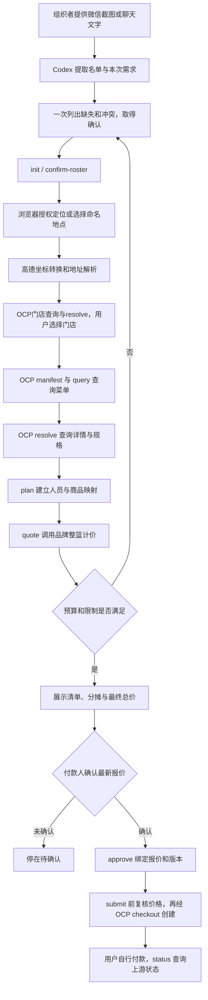

# 团餐管家：文件结构与执行流程

## 文件分别负责什么

|文件或目录|职责|
|---|---|
|`SKILL.md`|告诉 Codex 何时使用、如何理解需求、何时停止和如何取得真实购买授权|
|`agents/openai.yaml`|skill 在 Codex 中的名称、描述和默认提示|
|`references/commands.md`|命令、JSON 输入结构、金额单位、真实与模拟模式|
|`scripts/run.ps1`|定位独立运行目录和 Bun，将命令转交团餐 CLI|
|`assets/runtime/src/group-cli.ts`|命令入口，读取 JSON、打开任务数据库并选择品牌适配器|
|`group-types.ts`|任务、人员、规格、报价、确认等数据结构和输入校验|
|`group-store.ts`|SQLite 任务和已确认偏好、版本号、提交记录|
|`group-manager.ts`|需求确认、配餐、报价、售罄局部重配、审批和提交状态机|
|`group-catalog.ts`|将品牌菜单和整单动作映射为 OCP manifest/query/resolve 接口|
|`group-provider.ts`|品牌规格映射、同 SKU 合并、整篮报价、创建和查询订单|
|`group-gateway.ts`|连接瑞幸或麦当劳 MCP，限制开放工具，读取本机加密凭证|
|`store-discovery.ts`|品牌门店投影为OCP目录，提供manifest/query/resolve和快照分页|
|`location.ts`、`location-session.ts`|位置来源、坐标转换、本机命名地点和临时选店会话|
|`assets/runtime/public/location.html`|浏览器授权定位、展示门店和明确选择；不创建订单|
|`group-fixture.ts`、`group-demo.ts`、`group.test.ts`|不调用真实商家的模拟数据、演示与回归测试|
|`assets/runtime/`|独立运行所需的业务源码、测试和凭证配置脚本|

`assets/runtime/` 包含执行资产。此 skill 不依赖原 OCP 仓库或个人点单网页；OCP SDK 从 npm 安装。

## 一次任务如何执行

截图和聊天只是需求证据，不是执行授权。Codex 完成语言理解和选择；脚本执行确定的数据校验、版本控制和接口调用。`SKILL.md` 本身不会直接运行网络请求。

单次任务限制为一个品牌、一家门店、一个付款人、即刻到店自取。瑞幸查店要求经纬度；用户给地图链接后可提取坐标。商品名称和规格 ID 必须来自真实响应。如果“少甜”选项不存在，集中询问可用替代，不能悄悄改用默认甜度。

## 报价和售罄

逐人配餐先保留身份映射，上游整篮中同 SKU 才合并数量。整单总价来自品牌计价工具，不是搜索预估价相加。逐人金额按参考价比例分摊并修正到分，合计等于整单；它不是官方逐人交易价格。

明确售罄后 `unavailable` 标记 affected，`replace` 只接受这些人的新选择。其他人商品、规格、数量保持原样。随后重新报价并撤销旧审批。整单优惠重新分摊时，未换商品的人的展示金额仍可能改变。

## 防止重复提交

报价有效两分钟，审批绑定 quote_id、revision、总额和付款人。提交前再次计价，变化就重新展示并确认。调用真实创建之前先持久化提交标记；超时进入 unknown，禁止自动重试，先到官方 App 核对。成功后的重复 submit 只读取已保存结果。

## 安装与验证

详见仓库根目录 [README.md](../README.md)。安装依赖后执行 scripts/Install-Skill.ps1，安装指令文件并将本机 project.json 指向独立仓库。移动目录后重新安装。执行 bun run typecheck、bun run test，以及 scripts/run.ps1 demo 验证。

凭证和任务位于 assets/runtime/data，禁止上传。demo 全部模拟并包含模拟提交；只报价时分步执行并停在 quote。
